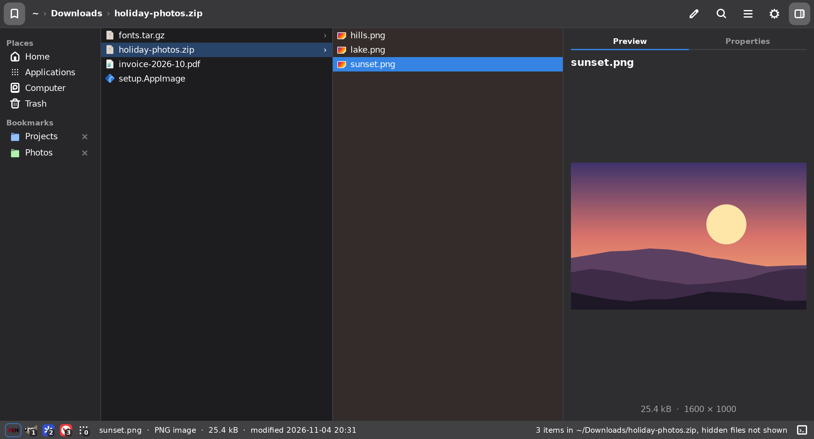

# qfm

A keyboard-driven file manager for Linux (GTK3) with Miller columns.



## Features

**Browsing**
- Miller columns that fit the window: up to three panels (configurable) split the width,
  with no horizontal scrolling; earlier ones are hidden and come back as you go left.
  Scrolling columns are an option.
- Opens as a floating window in the centre of the screen: Esc closes it, and it closes
  after opening something. It can also run as a normal window.
- Places (Home, Applications, Computer, Trash), removable drives, and bookmarks (× or
  right-click to remove them).
- Alt+← and Alt+→ (or the mouse's back and forward buttons) go back and forward through
  the places you jumped to.
- Git repositories have their own folder icon, and the status bar shows their branch.
- Archives (zip, tar, 7z, rar, iso) browse like folders, with their own background colour.
  Documents and packages that are archives inside (Office and LibreOffice files, EPUB,
  comic books, JAR, APK, wheels, 3MF…) open normally with Enter; → looks inside them.
- Optional thumbnails in the columns for images, PDFs and 3D models (and videos with a
  video thumbnailer installed), shared with other file managers' thumbnail cache.
- Folder sizes in the Size column, and sorting folders by size.

**Preview**
- Images (SVG included), text with syntax highlighting, PDFs, Illustrator, PostScript and
  EPS files, 3D models (STL, OBJ, PLY), and video and audio playback.
- Preview and Properties tabs (Ctrl+I), or one panel. Permissions can be changed in
  Properties with checkboxes.

**Opening and running**
- The status bar shows the apps that open the selection: the default (ringed) is what
  Enter does, Alt+1 to Alt+9 open with the others.
- Enter on a script or program asks whether to run it, run it in a terminal, or open it.
- F4 opens a terminal in the current folder. Apps that need a terminal (Neovim, ranger…)
  open in the one you have, Alacritty and kitty included.
- Your own commands on the selection (Run Command in the menu): a shell command with `%f` /
  `%F` (paths), `%n` / `%N` (names) and `%d` (folder), for the items you choose (`*.png`…),
  optionally in a terminal.

**Files**
- New file (Ctrl+N) and New From Template: text, Markdown, scripts, HTML, JSON, LibreOffice
  and Word documents, or your own once Customize Templates puts them in `~/Templates`.
- Rename several items at once (F2: find and replace, or a new name with numbers), select
  by pattern (Ctrl+S), duplicate (Ctrl+Shift+D), symbolic links (Make Link, or Ctrl+Shift+V
  to paste as links), compress and extract.
- Ctrl+Z undoes renames, moves, copies, trashing, new files and folders, duplicates, links,
  compressing and extracting.
- Copy and paste work between qfm and other file managers; copies show progress and can be
  cancelled.

**Keyboard and panels**
- Every action has a shortcut; F1 lists them all.
- The Actions panel (Ctrl+K) has everything the right-click menu has, with shortcuts, and
  follows the selection. Options (Ctrl+,) is a panel too. ↑ ↓ move through them, F6 jumps
  between them and the columns, Esc closes them.
- Questions (names, confirmations, conflicts, apps) appear in a bar at the bottom of the
  window, not in dialog windows.
- Optionally, qfm can be the default application for folders and for other applications'
  "Show in folder".

## Requirements

Arch Linux and X11. `install.sh` installs the required packages with pacman.

## Install

```bash
git clone https://github.com/davidnsousa/qfm.git
cd qfm
./install.sh
```

The installer asks for sudo and installs qfm in `/opt/qfm`. Run `./install.sh` again to
update. Run `qfm --uninstall` to remove it.

## Usage

```bash
qfm           # open at the last location
qfm PATH      # open at PATH (a file is selected in its folder)
```

If qfm is already open, the same window is used. Press F1 for the keyboard shortcuts, or
run `qfm --help`.

Options, bookmarks, folder colours and your commands are stored in `~/.config/qfm/`.

## License

MIT. See [LICENSE](LICENSE).
